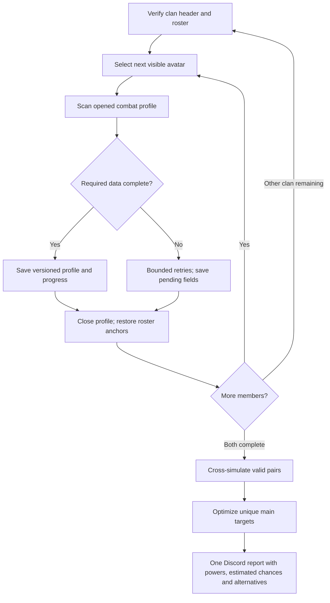

# Full clan combat simulation — initial TEST implementation

The initial Android AutoTest implementation adds a separate **Pełne profile klanów + symulacje (TEST)** entry. The fast power-only list remains available. This is experimental and requires user testing of real clan navigation; automated/static checks do not establish a successful 100-profile gameplay run.

The shared BattleOverlay scanner can now return a raw profile to the war controller without opening the combat dialog or replacing accepted self/opponent profiles. The war controller confirms the selected avatar against current roster artwork, validates the opened nickname, saves each result, closes the member profile back to the roster and proceeds through both clans. Missing fields remain pending. Saved profiles from the current Polish calendar day with unchanged clan/name/power are reused; an active checkpoint can continue across midnight with a 24-hour freshness limit; a separate new-scan action clears only full-war data. All calibration remains intact.

Profiles use their own preferences namespace. Pair checkpoints use individual SQLite rows with WAL so 2,500 results do not repeatedly rewrite one growing XML file. Stop cancels work and retains completed records. Cross-computation stops MediaProjection and runs on one background worker. A later scan needs a new screen-sharing session; its stored profiles/results are reused. Recovery provides an external profile editor that does not write accepted own/opponent slots. Unknown equipment fields require explicit selection instead of defaulting to three pets/a mount.

Each pair initially gets 128 seeded trials. The four leading candidates per ally and provisional global main targets are refined to 1,024 trials. The same existing PvpBattleEngine is used; scratch-array reuse is checked against its earlier implementation under identical seeds. Cached results are keyed by both profile hashes, war bonuses and model version `pvp-full-v1`. The backend computes the final weighted assignment and accepts only complete indexed matrix coverage with consistent win/loss/draw totals. Main targets require an estimated win rate strictly above 50%; shared fallbacks and up to two globally balanced alternatives are explicitly labelled. Missing or unsupported pairs have no numeric probability. Tira/reflect is blocked even when the bonus OCR is missing; automatic Mira acceptance requires its critical reduction to be read.

The `/report war-test` view supports experimental probabilities, sample counts, nominal 95% Wilson intervals, data-coverage counts, raw powers and up to two globally balanced alternatives. Its text attachment includes every pair. Equal clan bonuses are still assumed in TEST mode. Additional skill mastery outside the visible bonus list defaults to an explicitly documented 0% assumption and can be corrected in the editor. Timing rules and other current engine assumptions remain experimental. The full-profile entry is currently AutoTest-only; no production Sunday full-scan button is exposed yet.

The remainder records the design and follow-up considerations.

## Scan workflow

1. Read a bounded clan header, its expected member count, and visible member cards using existing avatar/name matching.
2. Tap a member's actual avatar box from the most recent stable frame. No fixed member ordering, nick or flag colour assumptions.
3. Use the existing battle-profile scanner to read damage, health, weapon type, bonuses, skills and levels, fairy and level, pets/mount state and other simulator inputs. Both clan sides use the opponent-style modal described by the user.
4. Refactor the interactive scanner into a shared scanning operation with a completion callback. Batch mode must not open a combat dialog or overwrite the user's saved own profile / current one-off opponent slot.
5. Verify that the opened profile belongs to the selected roster card. Save a versioned profile and its scan state immediately; then close the profile and resume the roster from its last confirmed visual anchors.
6. Retry ambiguous fields with existing contrast/icon/detail fallbacks. Distinguish confirmed absence (zero) from unreadable data (pending). Failed profiles stay pending; completed profiles survive Stop, disconnects and app restarts.
7. Finish our clan, then the rival clan. Counts come from each header and may be below 50. Never equate a complete power-only roster with complete combat profiles.

## Saved data and resumption

Separate batch records by war/opponent clan and member identity (clan, visual avatar/name evidence and local ID); include scan timestamp, profile schema version, fairy catalogue version and combat-rules version. The same nickname across two clans is not the same member. A confirmed profile that changes invalidates only its matrix row/column. Resume may reuse already complete records after identity/freshness checks; it must not reread all 100 profiles automatically.

Stop closes capture and cancels pending gestures immediately while retaining saved progress. A later explicit start re-arms capture and reacquires the correct clan and scroll anchors. Do not replay a saved row index after roster order changes.

## Computation and assignment

For 50 × 50 profiles there are 2,500 directed attack matchups. At 1,000 trials each, that is 2.5 million simulated fights, not just 2,500 fights. Benchmark the existing Kotlin PvpBattleEngine before promising completion time. It currently advances combat in 0.05-second steps and allocates arrays inside the combat loop; this needs profiling before running large batches on a phone. A server worker is an option only if it runs the same versioned engine/rules, rather than an independently maintained approximation.

Run on a bounded background worker, with progress and cancellation. An initial smaller trial budget can find promising pairs; allocate more trials to close candidates before final optimization. Cache outcomes by both profile hashes, war bonuses, model version and seed/trial budget. Report wins, losses, draws, trial count and uncertainty; do not present sampling precision as certainty about the game's mechanics.

Optimize the sum of estimated wins over the whole clan using a weighted bipartite assignment algorithm. Selecting each ally's favourite target independently would reuse opponents and can produce a worse global plan. The TEST eligibility threshold is strictly greater than 50%; the earlier requested policy leaves an ally without a main target if every evaluated matchup is unfavourable. Show up to two globally balanced alternatives with their own chances and label any shared fallback target explicitly. A global main target need not be that ally's highest individual probability, because another ally may need that opponent more.

## Known prerequisites and limits

The current engine explicitly uses experimental timing assumptions and refuses unsupported reflect effects. Full-profile scanning does not resolve those model limitations. Unsupported or incomplete profiles cannot silently receive a numeric chance. Validate a small set of profiles and recorded fights before scanning 100 people. Then test persistence/resumption and both-clan navigation, benchmark simulation, and finally add the full Discord probability report. Test mode may assume equal clan bonuses; real war results require the actual available rival bonuses. Do not fabricate probabilities from power differences.

The richer power-based Discord report is a separate deliverable and remains useful while this module is built.

## Test 65 recovery and alternative allocation

Alternative allocation now uses a separate global min-cost flow after main matching. Each player has at most two distinct eligible alternatives, excluding their main. Convex target costs balance total target usage across the clan, including primary targets; matchup quality resolves ties. Scarce feasible opponents may still repeat. Saved reports are rebalanced when rendered, without overwriting weekly records or changing main assignments. Approved update deployed as release-oQxJSn; public health verified HTTP 200 and matching release ID. All 99 Node tests passed. No example report message was posted.

Full-war checkpoints now persist both clan roster identities, confirmed readings, expected counts, current side/member, processed members, field sections and navigation phase in isolated storage. Partial profile fields are saved before prompts and failures. Resume skips completed sections and reacquires current avatar coordinates. The full-profile roster can tolerate changed order/power between profile visits; fast power-only overlap logic is unchanged. A clipped avatar is brought inside the list before tapping. Invalid header counts cannot replace a previously valid count. Retry Missing revisits incomplete members rather than restarting the whole procedure.

Private rolling diagnostics are in app cache/full_war-events.jsonl: stage/member, tap request/completion, scroll, field progress, save, stop and failures. The last rejected roster crop is cache/full-war-last-rejected.png. Logs contain player identifiers and scan state, never Discord pairing secrets. Diagnostics are bounded app-cache files and may be removed by Android; scan checkpoints themselves use persistent preferences/SQLite.

Test 66 also saves the exact bounded header input as cache/war-header-last.png, OCR passes as cache/war-header-last.txt and header bounds/text/parsed values in the rolling event log. The shared header reader retries only a failed crop using two contrast masks; success requires both a valid count and clan identity. The supplied Test 65 failure screenshot read 50/50 successfully under the exact stored calibration, so that replay alone does not establish the cause of the earlier live rejection.

The inspected Test 64 failure had 19 partial profiles and no complete ones. Existing fields remain reusable, but Test 64 did not persist the roster/job checkpoint, so the upgrade cannot reconstruct its historical exact list position. New Test 65 checkpoints provide that recovery going forward. Real 100-profile gameplay remains a user test.

## Test 71 — season 2026-11 fairies, incremental profiles and clan ranking

Tira is no longer rejected: from 2026-11-03 it converts +10% health steps into the Damage multiplier, which the displayed profile damage already includes. Reflect remains unmodelled and keeps its explicit no-probability guard. Mira's critical reduction is calculated on the phone from the per-step coefficient and the skill-cooldown substat. Profiles may be up to 8 days old (`PROFILE_MAX_AGE`) because the phone reuses unchanged members for a week. `/mobile/clan-ranking` stores a round-robin matrix of one clan (each unordered pair once) and `/report clan-ranking` ranks members by simulated points; unknown pairs fall back to power and are counted separately. A routing bug sent every `war-*` request through the resource handler (HTTP 400); fixed. War pairing keeps rank proximity (stronger allies on stronger rivals) as a secondary weight after win probability; covered by a regression.
